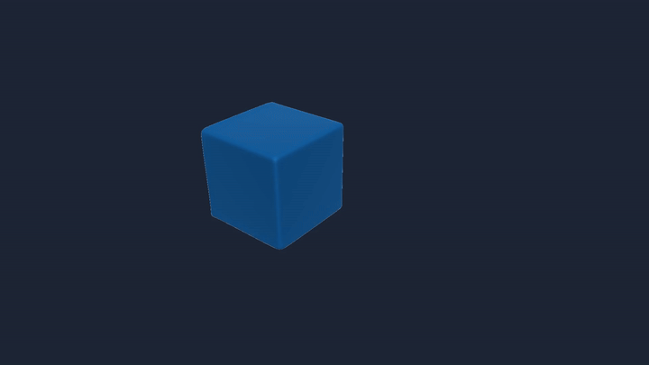

# SPHFluidSim — real-time implicit incompressible SPH

A from-scratch, real-time reproduction of **Implicit Incompressible SPH** (Ihmsen et al., IEEE TVCG 2013) and a **Divergence-Free SPH** solver (Bender & Koschier 2017), in C++17 + OpenGL 3.3 + Qt 6 + OpenMP, running on Windows (MinGW + CMake). The desktop UI is available as both **Qt Widgets** and **Qt Quick/QML**, with four switchable skins.

Repository: **https://github.com/EMEEEEMMMM/SPHFluidSim**

---

<div align="center">
  
  <br>
  <small>SPHFluidSim.exe --headless --seconds 20 --output demo_dam --fps 120 -r 1920x1080 --scene dam --drop 5s --grid 0.5 --particles 64000 --solver DFSPH</small>
</div>

## Features

- **IISPH solver** (paper Alg. 1): implicit density constraint via relaxed-Jacobi pressure solve (`omega = 0.5`, negative pressure clamped to 0, warm start `p^0 = 0.5 p(t-dt)`), CFL step limiter (`dt <= 0.4 d/vmax`, paper Sec.3.1), single-layer boundary particles with Akinci-2012 volumes, XSPH viscosity (Schechter & Bridson 2012, as in SPlisHSPlasH) and surface tension (Akinci et al. 2013: color-field normals + cohesion + curvature + boundary adhesion)
- **Water surface reconstruction** (Akinci et al. 2012): color-field surface particles, distance-to-weighted-centroid scalar field `phi = |x - xbar| - r`, Marching Cubes lookup tables with shared-edge intersection reuse (watertight, crack-free), opaque fresnel water shader
- **Parallelism** (Ihmsen et al. 2011 style): SoA spatial hash built in 3 passes — atomic count -> prefix sum -> atomic scatter; no locks, cache-friendly neighbor slices; reconstruction runs on a background thread (never stalls the render loop)
- **Qt desktop frontends**: native Qt Widgets and Qt Quick/QML share the same simulation session, renderer and theme tokens; frameless window, pause / single step / reset, a particle-count field, solver and surface parameters, particles-only / surface-only / both view modes, FPS + tank overlay, four switchable skins
- **Live density diagnostics**: mean density in real kg/m³ with a labelled `rho0` reference; the axis follows the data (a stable DFSPH run still fills the chart), and when rho0 lies far off that range it is reported as off-scale rather than flattening the trace. The trace is banded by the solver's density error (green ≤ 0.10 %, amber 0.10-1 %, red ≥ 1 %, i.e. an order of magnitude around the ~0.01 % a converged run holds), and hovering a sample shows sim time, step, density and Δρ
- **DFSPH solver** (Bender & Koschier 2017, `--solver DFSPH`): constant-density + divergence-free solvers with warm start, sharing the same boundary / XSPH / surface-tension passes as IISPH
- **Deterministic pressure solve**: the IISPH iteration reads the previous pressure and writes the next one (`m_P` / `m_Pold`, strict relaxed Jacobi), so results no longer depend on thread scheduling
- **Headless mode**: offline simulation -> offscreen render -> ffmpeg streaming encode (frames piped straight to the encoder, no BMPs on disk; ~500 MB mp4 instead of ~90 GB of BMPs for a 14400-frame 1080p run)
- **Particle export** (headless only): `--export-particles` dumps one binary PLY per frame for Houdini / Blender, with a disk-space pre-check before the simulation starts

---

## Build & run

### Requirements

| dependency | needed for | notes |
|---|---|---|
| CMake 3.16+ | build | any generator; the commands below use MinGW Makefiles |
| MinGW-w64 g++ (MSYS2 UCRT64) or GCC/Clang on Linux | build | OpenMP is required (`find_package(OpenMP REQUIRED)`) |
| Qt 6.5+ **Core, Gui, Widgets, Quick, QuickControls2, OpenGL, OpenGLWidgets** | GUI | tested with Qt 6.12.0 / UCRT64 |
| Assimp | OBJ/FBX/STL import | `find_package(assimp CONFIG)` first, `pkg-config assimp` as fallback |
| OpenGL 3.3 | renderer | GLAD is vendored in `thirdparty/` |
| OpenCL (optional) | GPU surface reconstruction | CPU reconstruction is used when missing |
| CUDA Toolkit headers `cuda.h` + `nvrtc.h` (optional) | CUDA backend | headers only; no `nvcc`, no import library |
| ffmpeg (optional) | headless mp4 output | without it the runner keeps BMP frames |

### Windows (MSYS2 UCRT64, tested)

```bash
pacman -S --needed mingw-w64-ucrt-x86_64-gcc mingw-w64-ucrt-x86_64-cmake \
    mingw-w64-ucrt-x86_64-ninja mingw-w64-ucrt-x86_64-assimp \
    mingw-w64-ucrt-x86_64-qt6-base mingw-w64-ucrt-x86_64-qt6-declarative
```

```powershell
# configure (Release + CUDA autodetected when the headers are installed)
cmake -S . -B build -G "MinGW Makefiles" -DCMAKE_BUILD_TYPE=Release `
      -DCMAKE_PREFIX_PATH="C:/msys64/ucrt64"

# build everything: app, tests, GPU benchmark
cmake --build build --parallel

# run the GUI
.\build\SPHFluidSim.exe
```

`CMAKE_PREFIX_PATH` can be omitted when Qt 6 already sits in a standard prefix
(the project also probes `D:/msys64/ucrt64`, `C:/msys64/ucrt64` and a few Qt
install directories). The build is single-configuration, so
`-DCMAKE_BUILD_TYPE=Release` is fixed at configure time; use `Debug` when you
need symbols.

Build options:

| option | default | effect |
|---|---|---|
| `-DSPH_ENABLE_CUDA=ON/OFF` | `ON` | compile the CUDA backend when `cuda.h`/`nvrtc.h` are found |
| `-DCMAKE_BUILD_TYPE=Release/Debug` | — | optimisation level |
| `-DCMAKE_PREFIX_PATH=<qt6-prefix>` | autodetect | Qt 6 installation |

Run the test suite (CPU reference, CUDA parity, model import, parameter JSON):

```powershell
ctest --test-dir build --output-on-failure
```

If you move the executable outside the Qt environment, deploy its runtime next
to the binary:

```powershell
windeployqt .\build\SPHFluidSim.exe
```

### Linux

```bash
sudo apt install build-essential cmake ninja-build \
    qt6-base-dev qt6-declarative-dev libassimp-dev libgl1-mesa-dev ocl-icd-opencl-dev
cmake -S . -B build -DCMAKE_BUILD_TYPE=Release
cmake --build build --parallel
./build/SPHFluidSim
```

`SPH_ENABLE_CUDA=ON` (the default) also works there: the backend `dlopen`s
`libcuda.so.1` and `libnvrtc.so`, so only the CUDA headers are needed at build
time. Pass `-DSPH_ENABLE_CUDA=OFF` on machines without them.

The Windows executable is a native PE binary and **cannot** be copied to a Linux GPU server. Rebuild it on the server (the commands above); the CUDA kernels are compiled from the embedded source at runtime by NVRTC, so the server needs a driver plus `libnvrtc` (CUDA toolkit/runtime), not `nvcc` at build time.

### CUDA backend

The optional CUDA backend is compiled when `cuda.h` and `nvrtc.h` are found. It
loads `nvcuda` and NVRTC at runtime, so no CUDA import library or `nvcc` is
required at link time (MinGW keeps working). NVRTC installations from CUDA 11
through 13 are discovered from `CUDA_PATH`/`CUDA_HOME` and the standard install
directories; the same source also builds on Linux with `libcuda.so.1` and
`libnvrtc.so`.

```powershell
# correctness: CPU vs GPU, IISPH + DFSPH
.\build\test_cuda_parity.exe

# MS/step for 8k / 32.8k, solver-only and render-synchronised
.\build\benchmark_gpu.exe 30

# add ~125k-particle cases and print max neighbor count
.\build\benchmark_gpu.exe 10 --large
```

On Linux:

```bash
cmake -S . -B build -DCMAKE_BUILD_TYPE=Release -DSPH_ENABLE_CUDA=ON
cmake --build build --parallel
./build/test_cuda_parity
./build/benchmark_gpu 30 --large
```

Implementation notes:

- particle state and neighbor data stay on the device; accessors synchronise
  only the requested field, so a pure simulation loop has no per-step D2H copy;
- the spatial hash uses device-side count/scan/scatter; each fluid pair is
  emitted once and mirrored into both lists, halving discovery/gradient work;
- per-pair gradient/distance is cached once per neighborhood rebuild and reused
  by density, IISPH Jacobi iterations and both DFSPH solvers; the neighbor index
  is packed into the gradient record, removing a separate 4-byte stream from
  every pressure iteration;
- DFSPH reuses its end-of-step neighborhood, density and stiffness at the next
  step start (positions are unchanged until the next integration), eliminating
  one full rebuild and one density pass per step;
- DFSPH boundary pressure terms use the precomputed `gradB`, and paired passes
  (density + stiffness, integrate + wall clamp, finalize + warm start) are fused;
- tiny reduction/bounds readbacks use pinned host staging; redundant reductions
  that cannot affect the mandatory minimum iteration count are skipped;
- `SPH_CUDA_DEVICE=N` selects a GPU, `SPH_CUDA_PROFILE=1` prints build/predict/
  solve timings, `SPH_CUDA_KERNEL_PROFILE=1` prints per-kernel device times
  (`SPH_CUDA_KERNEL_PROFILE_SKIP=N` starts after N steps), and
  `SPH_CUDA_DUMP_PTX=path` writes the generated PTX.

The mirrored neighbor insertion uses atomic slot allocation, so CUDA results can
differ in the last few floating-point bits between runs; the CPU reference
remains bit-reproducible. Parity tests are tolerance-based for this reason.

Measured CPU/CUDA numbers for 8k / 32.8k / 125k particles and the memory-per-particle sizing are in **[PERFORMANCE.md](PERFORMANCE.md)**. That report contains only measurements taken on the Quadro P600 test machine; no data for other GPUs is included because they were not available for testing.

### GPU memory limits

One fluid particle keeps about **1.6 KiB** of device memory (state, pressure / DFSPH scratch, plus 64 fluid and 48 boundary neighbor slots). The neighbor capacity dominates: 64 × 20 B + 48 × 4 B ≈ 1.45 KiB of the total.

The backend measures the device budget *before* building a scene and reports the number of particles that fit on the actual card:

| GPU | usable device memory | particles that fit |
|---|---|---|
| Quadro P600 (2 GB) | ~1.6 GB | ~870 000 |

For other cards, use the pre-flight message: 1 000 000 particles need about 1 846 MiB, 10 000 000 need about 18.6 GB, and 100 000 000 need about 186 GB. The last case does not fit a single GPU; multi-GPU is not implemented.

If the requested count does not fit, nothing is allocated and nothing breaks:

- GUI: the particle field turns red with `needs X MB / Y MB free`, and the
  rebuild is refused with a message in the status bar; the running scene keeps
  stepping.
- Headless / CLI: the runner prints the reason and exits with code 1, e.g.

```
[headless] cannot build the scene: not enough GPU memory for about 1000000 particles:
needs about 1846 MiB, only 1619 MiB usable (1619 MiB free of 2048 MiB).
Lower the particle count to about 867000.
```

Windows (WDDM) would otherwise silently page device memory into system RAM, which "works" but runs an order of magnitude slower, so the pre-flight check is deliberate. The CPU backend has no such limit (it is bounded by system RAM).

The paper's Table 1 benchmark is **WCSPH**, not DFSPH, and explicitly excludes
prefix-sum time. It is therefore not a like-for-like target for this project's
IISPH/DFSPH numbers. Use the same scene and particle count when comparing GPUs.

### Desktop frontends

The default UI is **Qt Quick/QML**. Both frontends share the same session, renderer and four themes:

```powershell
.\build\SPHFluidSim.exe                      # QML frontend, Cupertino Dark
.\build\SPHFluidSim.exe --ui widgets         # Qt Widgets frontend
.\build\SPHFluidSim.exe --ui qml --theme 1   # Cupertino Light
.\build\SPHFluidSim.exe --ui qml --theme 2   # Linear Dark
.\build\SPHFluidSim.exe --ui qml --theme 3   # Swiss Light
.\build\SPHFluidSim.exe --screenshot shot.png --delay 1500   # UI smoke test
```

| theme | name | character |
|---|---|---|
| `0` | Cupertino Dark | charcoal material layers, 12 px radii, Apple system blue `#0A84FF` |
| `1` | Cupertino Light | `#F5F5F7` page, white cards, soft shadows, black selected segments, `#007AFF` |
| `2` | Linear Dark | near-black high-density layout, 8 px radii, indigo `#6E79D6`, mono numerals |
| `3` | Swiss Light | pure-white grid, square corners, orange-red `#E8501E`, black selected states |

### GUI controls

- **Transport** — pause / resume (`Space`), single step (`S`), reset (`R`)
- **Scene** — dam break (open-top) / inflow jet; switching rebuilds the solver and asks for confirmation
- **Spawn water drop** (dam scene) — one-shot spherical blob above the tank rim
- **Particles** — type any fluid-particle count of 512 or more; there is no application-level upper cap. Spacing follows from the scene's fixed water volume, and the box under the field shows the resulting spacing plus the estimated device memory. On CUDA, the count is checked against the active GPU budget as soon as it is entered; an overloaded request is marked in red and is not applied. The same preflight is used by the render dialog. The `Active` row always reports the particle count the solver really built (a non-cubic number rounds up to the lattice, e.g. 500 000 → 512 000)
- **Solver / forces / surface** — IISPH or DFSPH, XSPH viscosity, surface tension, wall adhesion, threshold, grid scale, rebuild interval
- **View** — particles / surface / both; surface mode also reconstructs while paused
- **Camera** — two modes only: **Orbit** (left-drag orbits the target) and **Fly** (left-drag looks around from the current eye, `WASD` moves, `Q/E` moves down/up). Middle/right-drag pans, the wheel changes the **field of view** and stops exactly at 20° / 75° (the same ends as the Field-of-view control), double-click or **Reset view** restores the camera. `S` is a single step in Orbit mode and "move backwards" in Fly mode.
- **Density chart** — plots the real mean density in `kg/m³` with a `ρ₀` reference line; hover any point to read its simulation time, step number, density and signed density error
- **Navigation bar** — `File` (restart, save snapshot, exit), `Appearance` (four skins with preview swatches and current selection), `Help` (shortcuts, about)
- **Window** — minimize / maximize / close at the top right; screenshot (`Ctrl+S`), fullscreen (`F11`), and `Ctrl+T` still cycles appearances

---

## Headless mode (offline video)
Make sure that ffmpeg is installed on your computer.

Frames are streamed directly into ffmpeg over a pipe (rawvideo), so **no BMP
files are written** and the only disk usage is the final mp4. BMP frames are
only written with `--no-video` (debug / manual encode) or `--keep-frames`.

`--seconds` controls **video duration**, while `--time-scale` controls how much
simulation time elapses per video second. The default `--time-scale 1` gives
real-time playback: the runner executes as many solver steps as needed before
each rendered frame instead of treating one solver step as one video frame.
Use `0.1` for 10x slow motion or `2` for 2x fast motion. Changing `--fps` then
changes only the output sampling rate, not the underlying physical trajectory.
`--drop 3s` uses the same video timeline; at the default time scale it appears
3 seconds into both the video and the simulation.

```powershell
.\build\SPHFluidSim.exe --headless --seconds 10 --output drop_demo
# -> drop_demo/output.mp4 only (no frames/); default scene = dam break (open-top)
```

### Scenes (`--scene`)

| scene | description |
|---|---|
| `dam` (default) | classic dam break in an **open-top** 2.0x1.2x1.0 m tank (no lid, splash may leave the tank); optional `--drop <N>[f|s]` spawns a water drop above the rim |
| `inflow` | open-top 1.0 m cubic container with a continuous central jet falling 0.5 m from above (injects until `--particles` is reached, then stops - fixed volume) |

All scenes render their container/tank as a wireframe outline.

**Fixed water volume**: each scene defines a physical water volume (dam 0.512 m^3, inflow 0.6 m^3; the optional drop adds a fixed 0.034 m^3 sphere); `--particles N` derives the spacing from
`spacing = (volume / N)^(1/3)`, so 8000 or 16000 particles show the *same*
water volume - only the resolution changes. N is a target: the lattice is built
with `ceil(size / spacing)` per axis, so the actual count can be slightly higher
(e.g. 1000000 → 1000000, 500000 → 512000); the printed `particles=` line always
reports the count that was really created.

### Options

| option | default | description |
|---|---|---|
| `--headless` | — | run without a window (video output) |
| `--frames N` | 300 | number of simulated frames |
| `--seconds S` | — | video length in seconds (frames = `S * fps`; overrides `--frames`) |
| `--time-scale S` | 1.0 | simulated seconds per video second: `1` = real time, `0.1` = 10x slow motion, `2` = 2x fast motion |
| `--fps N` | 30 | video frame rate / output sampling rate |
| `-r WxH` | 1280x720 | render resolution |
| `--output PATH` | `out` | output directory (`output.mp4`, or `frames/` with `--no-video`/`--keep-frames`) |
| `--mode MODE` | `surface` | `particles` (points) or `surface` (reconstructed mesh) |
| `--solver S` | `IISPH` | `IISPH` \| `DFSPH` (case-insensitive; DFSPH = Bender & Koschier 2017) |
| `--backend B` | `auto` | `auto` \| `cpu` \| `cuda`; `auto` picks CUDA when it can be created |
| `--particles N` | 8000 | target number of fluid particles (spacing = (scene water volume / N)^(1/3)) |
| `--scene S` | `dam` | `dam` \| `inflow` (see Scenes above) |
| `--drop N[f/s]` | off | spawn the one-shot water drop at video frame N, or N video seconds (`20f`/`20s`; dam only); its simulation time is scaled by `--time-scale` |
| `--dt T` | auto (CFL) | nominal time step in seconds; CFL may shorten it |
| `--grid S` | 1.0 | surface grid scale (1.0 = paper r, 0.5 = fine/high quality) |
| `--threads N` | all cores | OpenMP thread count |
| `--no-video` | off | write BMP frames only, skip ffmpeg encode (debug / manual encode) |
| `--keep-frames` | off | write BMP frames too and keep them after encoding (old behaviour) |
| `--export-particles` | off | dump per-frame particle positions to `<output>/particles/frame_%04d.ply` (binary PLY, headless only) |
| `--bench NAME` | — | run a validation experiment and exit: `hydrostatic` \| `dambreak` \| `energy` |

### Examples

```powershell
# default scene (dam break, open-top): 0.8 m water cube collapses, 10 s @ 30 fps, 1080p HQ surface
SPHFluidSim.exe --headless --seconds 10 --fps 30 -r 1920x1080 --grid 0.5 --output hi

# dam break with a water drop spawned at 3 s into the video
SPHFluidSim.exe --headless --seconds 10 --scene dam --drop 3s --output dam

# inflow jet (strong central jet, falls 0.5 m)
SPHFluidSim.exe --headless --seconds 15 --scene inflow --particles 12000 --output jet

# particle-points video, fixed dt
SPHFluidSim.exe --headless --seconds 20 --mode particles --particles 33000 --dt 0.002 --output pv

# render frames only (no ffmpeg), then encode manually
SPHFluidSim.exe --headless --frames 120 --no-video --output raw
ffmpeg -framerate 30 -i raw/frames/frame_%04d.bmp -pix_fmt yuv420p raw.mp4

# DFSPH + per-frame particle positions for Houdini / Blender
SPHFluidSim.exe --headless --seconds 20 --fps 120 -r 1920x1080 --particles 100000 --solver DFSPH --export-particles --output dam_ply
```

---

## References

Five papers this reproduction is built on. `[n]` is the citation index used in the IISPH paper.

1. **M. Ihmsen, J. Cornelis, B. Solenthaler, C. Horvath, and M. Teschner,** "Implicit incompressible SPH," *IEEE Transactions on Visualization and Computer Graphics*, vol. 20, no. 3, pp. 426-435, 2014. (main paper, also listed as TVCG 2013 early access). DOI: 10.1109/TVCG.2013.105
2. **J. J. Monaghan,** "Smoothed particle hydrodynamics," *Reports on Progress in Physics*, vol. 68, no. 8, pp. 1703-1759, 2005. [23] DOI: 10.1088/0034-4885/68/8/R01
3. **M. Becker and M. Teschner,** "Weakly compressible SPH for free surface flows," in *Proc. ACM SIGGRAPH/Eurographics Symposium on Computer Animation (SCA)*, San Diego, CA, 2007, pp. 209-217. [5] DOI: 10.5555/1272690.1272719 (ACM legacy DOI; confirmed via DBLP)
4. **G. Akinci, M. Ihmsen, N. Akinci, and M. Teschner,** "Parallel surface reconstruction for particle-based fluids," *Computer Graphics Forum*, vol. 31, no. 6, pp. 1797-1809, 2012. [32] DOI: 10.1111/j.1467-8659.2012.02096.x (Note: the citation printed in the IISPH paper — "vol. 32, no. 1, pp. 99-112" — is garbled; 99-112 belongs to the Ihmsen 2011 paper below. CrossRef confirms the record above.)
5. **M. Ihmsen, N. Akinci, M. Becker, and M. Teschner,** "A parallel SPH implementation on multi-core CPUs," *Computer Graphics Forum*, vol. 30, no. 1, pp. 99-112, 2011. [30] DOI: 10.1111/j.1467-8659.2010.01832.x

---

## Notes on my blog
The notes I took when I was working on this project are all on [my blog](https://emeeeemmmm.github.io/).

Deepseek v4 Flash was used during this project.
